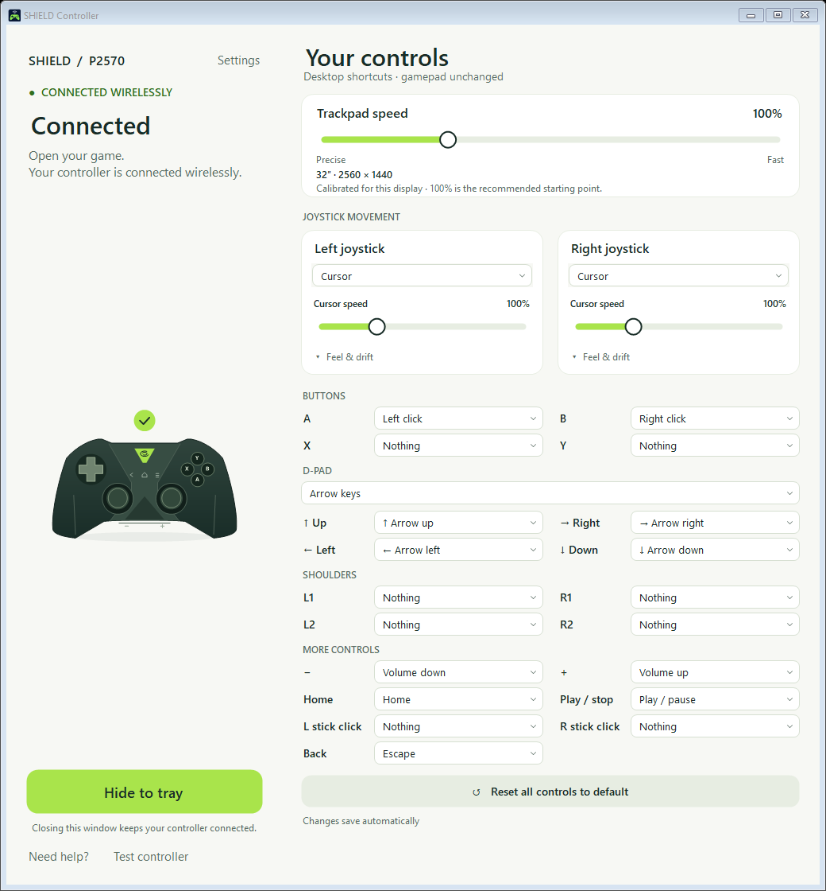

  
  <h1>SHIELD. Untethered.</h1>
  
Your original <b>NVIDIA SHIELD P2570</b>, back in play.

  

  
Windows 11 · 24H2 or newer · x64

1. **Install.** Open the download and click **Install & play**. Setup gets the drivers for you; approve the Windows and Npcap prompts when asked.
2. **Hold.** Unplug USB from the PC. Touch the green NVIDIA logo for **3 seconds** until it flashes.
3. **Play.** Click **It's flashing**. Follow the picture until the app says **Connected**. You're ready!

No accounts. No terminal commands. No dependency hunting. First-time setup needs Internet access.

**Make it yours.** Adjust trackpad speed, change any button, or reset everything with one click. Closing the window keeps your controller running in the tray.

You'll need an **original P2570** and a **PC Wi-Fi adapter that supports 5 GHz** for this Windows app. Your router does not need to use 5 GHz. Ethernet is recommended. [Check your PC](docs/compatibility.md) · [Pairing picture and help](docs/guide.md)

[Linux preview and macOS status](docs/platforms.md) · [Build from source](BUILDING.md) · [All releases](https://github.com/egokick/NVIDIA-SHIELD-P2570-Windows/releases)

Independent community project. Uses Wi-Fi, not Bluetooth. Installer is currently unsigned. [GPL-2.0](LICENSE) · [Credits](THIRD-PARTY.md)
