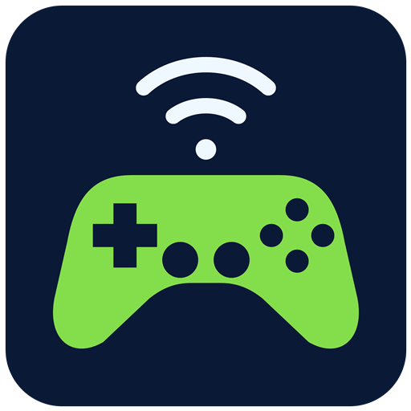

# NVIDIA SHIELD P2570 for Windows

Use the **original NVIDIA SHIELD P2570 controller wirelessly** as an Xbox-compatible gamepad on Windows. A small tray app guides you through pairing and shows whether the controller is paired, waiting to connect, or connected.

**[Download the Windows installer](https://github.com/egokick/NVIDIA-SHIELD-P2570-Windows/releases/latest)**

This is an independent community project, not an NVIDIA product. The P2570 uses **Wi-Fi**, not Bluetooth. This app is for the original P2570, not the later Bluetooth SHIELD controller.

## Get started

1. Run **NVIDIA-SHIELD-P2570-Windows-Setup-0.1.1.exe** and click **Install**.
2. Unplug the controller's USB cable from the PC. Touch and hold the green NVIDIA logo for **three seconds**, until it flashes. The picture in the app shows where to touch; the logo does not click. A wall USB charger is fine.
3. Click **It's flashing**. The app finds, pairs, and connects your controller automatically. If it finds more than one controller, choose yours.
4. When asked, tap the NVIDIA logo once and move a stick. **Connected** means your controller is sending wireless input. Open your game and choose its Xbox/controller input.

If your PC needs a driver, the app shows one setup button at a time. Click it and follow the official installer's prompts. Network adapters are selected automatically when there is one clear choice; the app asks you to choose in **Settings** when needed.

Next time, open the app and briefly touch the NVIDIA logo. Your pairing is saved, and the app starts the connection automatically. **Done**, **Hide to tray**, or closing the window keeps it running while you play. Click its tray icon to reopen it. **Settings → Disconnect** stops the connection; **Exit** in the tray menu closes the app and restores the network settings it temporarily changed.

The app installer needs no .NET or developer tools. Driver installation may require a Windows administrator prompt. Npcap is installed separately through its official interactive setup. The app downloads the official driver installers directly and verifies their signatures and hashes before opening them.

## Requirements and tested hardware

- **Windows 11 24H2 or later, x64.** The app checks for the required Windows networking APIs.
- An original **NVIDIA SHIELD P2570** with sufficient battery charge.
- A Wi-Fi adapter with Windows Mobile Hotspot support and **5 GHz channel 36** available. Attach the PC's Wi-Fi antenna.
- **Exactly one enabled Wi-Fi adapter.** Disable additional Wi-Fi adapters while using this release; Bluetooth adapters do not count.
- An active Internet-capable network connection for Windows Mobile Hotspot. **Ethernet is recommended.**
- **[Npcap](https://npcap.com/)** and **[ViGEmBus](https://github.com/nefarius/ViGEmBus/releases/tag/v1.22.0)**. Setup checks for these and provides installation buttons. Leave Npcap's administrator-only option unchecked so the tray app can run normally.

The working wireless path has been tested with **P2570 firmware Ozmo 81, Realtek RTL8852CE motherboard Wi-Fi, and Windows 11 build 26300**. Actual stick movement and button presses reached Windows XInput. This does **not** establish compatibility with every adapter, Windows build, or controller firmware. Unsupported capabilities produce an error instead of changing driver settings.

This release supports one controller and the standard gamepad sticks, buttons, D-pad and triggers. It also controls the Windows desktop:

| Controller | Windows action |
|---|---|
| Touchpad | Move the mouse; press to left-click |
| A / B | Left-click / right-click; hold A to drag |
| D-pad | Keyboard arrow keys; hold to repeat |
| − / + | Volume down / up; hold to keep adjusting |

Touchpad speed adjusts to the monitor under the pointer at the start of each swipe, using its physical resolution with DPI-aware measurement. Windows pointer speed and acceleration still apply. Arrow repeat follows your Windows keyboard settings. These desktop actions work alongside the Xbox gamepad buttons, so a game that accepts both can respond to both. Disconnecting releases all held buttons and keys.

The − / + controls adjust the current default playback device directly; + also unmutes it. The **Arctis Nova Pro Wireless** reports a fixed Windows volume of 100%, so this app adjusts that headset's actual hardware volume instead. Its base-station volume changes, while the Windows slider remains fixed. This headset control requires one matching base station and affects the wireless headphones, not its Line Out. No audio drivers or routing settings are changed.

Controller headset audio, microphone and vibration are not implemented. ViGEmBus is an archived upstream project; its final signed release is used here.

## What the tray status means

| Status | Meaning |
|---|---|
| Let's connect | Touch and hold the logo until it flashes, then click **It's flashing**. |
| Finding / Pairing | Keep the logo flashing while the app finishes setup. |
| Not connected yet | Pairing is saved and the PC is listening. Tap the logo once, then move a stick. |
| Connected | The controller is sending actual wireless gamepad reports to Windows. |
| Disconnected | Pairing is saved, but the connection is stopped. Click **Connect**. |
| One quick setup / A quick fix first | Follow the instruction and use the large button. More detail is in **Settings**. |

The tray tooltip also distinguishes **Not paired**, **Pairing**, **Paired · disconnected**, **Connected**, and **Needs attention**. Pairing alone is never reported as a live connection. The app only accepts the paired controller's network identity and creates one virtual Xbox controller.

**Test controller** opens Windows' standard Game Controllers panel. Set controller bindings and sensitivity in your game. **Settings** holds network choices, setup checks, logs, and connection controls. To change the saved controller or network adapters, disconnect, choose **Forget controller…**, confirm, and pair again. This removes the app's saved pairing; it does not reset controller firmware.

## If it will not pair

- Charge the controller first. The small light beside its USB socket is a charging light; watch the **NVIDIA logo itself** for pairing.
- Unplug USB from the PC before wireless pairing. A wall charger can supply power without a USB data connection.
- If the logo will not flash, hold it for **15 seconds**, release, wait five seconds, then hold it for about three seconds again.
- Close other mobile hotspots or Wi-Fi Direct apps and retry.
- If the app reports an unsupported channel or adapter, see [compatibility and troubleshooting](docs/compatibility.md). Do not install random replacement Wi-Fi drivers or disable driver signing.

Uninstall through **Windows Settings → Apps**. Uninstalling keeps shared Npcap/ViGEmBus drivers and your private pairing details, so it does not break other applications.

## Privacy and permissions

No account, telemetry or cloud service is used for pairing or play. Pairing credentials stay in your Windows profile with access restricted to your account. The app temporarily starts its own hotspot and restores the prior idle-timeout policy when it stops. It does not register a system service, flash controller firmware, or replace the controller's USB driver.

The release is currently **unsigned**; Windows may show an unknown-publisher warning. Download only from this repository's Releases page and compare the included SHA-256 checksum if needed.

## Build and contribute

See [BUILDING.md](BUILDING.md) for the Windows build, tests and installer. Please include your Windows build, Wi-Fi adapter/driver, controller model and the app's error stage when reporting an issue. **Do not post pairing configuration files, Wi-Fi passwords or raw packet captures.**

The source is licensed under **GPL-2.0-only**. The protocol implementation builds on [satyrnidae/shieldd](https://github.com/satyrnidae/shieldd); see [THIRD-PARTY.md](THIRD-PARTY.md) and the bundled notices for attribution and dependency licences. Npcap and ViGEmBus remain separately installed upstream components.
