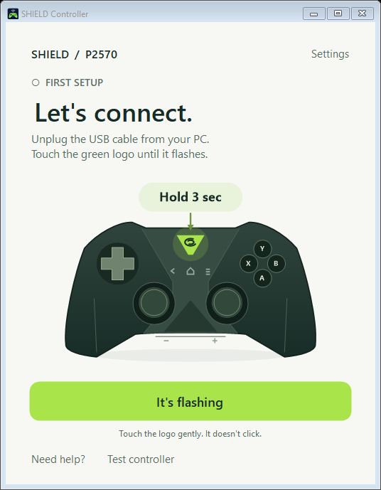

# Windows user guide

[← Back to the download page](../README.md)

## Get started

1. Run **SHIELD-Controller-Setup.exe** and click **Install & play**.
2. Unplug the controller's USB cable from the PC. Touch and hold the green NVIDIA logo for **three seconds**, until it flashes. The picture in the app shows where to touch; the logo does not click. A wall USB charger is fine.
3. Click **It's flashing**. The app finds, pairs, and connects your controller automatically. If it finds more than one controller, choose yours.
4. When asked, tap the NVIDIA logo once and move a stick. **Connected** means your controller is sending wireless input. Open your game and choose its Xbox/controller input.

Setup checks the required drivers, includes the gamepad driver, and downloads Npcap from its official website when needed. Follow the Npcap licence and Windows approval prompts; Setup resumes the check for you. Network adapters are selected automatically when there is one clear choice; the app asks you to choose in **Settings** when needed.

Leave the Npcap options as Setup selects them. Non-administrator capture is required and locked on; raw 802.11/monitor mode and WinPcap compatibility are not required. Setup preserves those optional features if another application already uses them, and checks that both drivers can load before finishing.

Next time, open the app and briefly touch the NVIDIA logo. Your pairing is saved, and the app starts the connection automatically. **Done**, **Hide to tray**, or closing the window keeps it running while you play. Click its tray icon to reopen it. **Settings → Disconnect** stops the connection; **Exit** in the tray menu closes the app and restores the network settings it temporarily changed.

The app installer includes its .NET runtime and the gamepad driver. A first installation needs Internet access to download Npcap; its free licence requires its own interactive setup. Setup verifies the official driver files before opening them. Windows administrator approval may be required. You do not need to find or download dependencies yourself.

## Requirements and tested hardware

- **Windows 11 24H2 or later, x64.** The app checks for the required Windows networking APIs.
- An original **NVIDIA SHIELD P2570** with sufficient battery charge.
- A Wi-Fi adapter with Windows Mobile Hotspot support on **5 GHz**, using channel **36, 40, 44, 48, 149, 153, 157, 161 or 165**. Attach the PC's Wi-Fi antenna. Controller input requires 5 GHz. Temporary discovery and pairing can use 2.4 or 5 GHz.
- **Exactly one enabled Wi-Fi adapter.** Disable additional Wi-Fi adapters while using this release; Bluetooth adapters do not count.
- An active Internet-capable network connection for Windows Mobile Hotspot. **Ethernet is recommended.**
- **Npcap and ViGEmBus.** Setup handles both. The correct Npcap options are preselected; approve its licence and Windows prompts when asked.

The working wireless path has been tested with **P2570 firmware Ozmo 81, Realtek RTL8852CE motherboard Wi-Fi, and Windows 11 build 26300**. Actual stick movement and button presses reached Windows XInput. This does **not** establish compatibility with every adapter, Windows build, or controller firmware. Unsupported capabilities produce an error instead of changing driver settings.

This release supports one controller and the standard gamepad sticks, buttons, D-pad and triggers. It also controls the Windows desktop:

| Controller | Windows action |
|---|---|
| Touchpad | Move the mouse; press to left-click |
| Left / right stick movement | Move the cursor; each stick has its own movement mode and speed |
| A / B | Left-click / right-click; hold A to drag |
| D-pad | Keyboard arrow keys; hold to repeat |
| − / + | Volume down / up; hold to keep adjusting |
| Play / pause | Toggle media playback |
| Home / Back | Home / Escape keys |
| X, Y, shoulders, triggers, stick clicks | No desktop action until you choose one |

When **Connected**, the app shows your desktop controls beside the controller picture. Use the **trackpad sensitivity slider** to make the pointer slower or faster. Its 100% default is calibrated to the monitor's resolution and reported physical size; Windows display scaling provides a size estimate when the monitor does not report one. Windows pointer speed and acceleration still apply.

Each stick has a separate **Movement** menu and **Speed** slider. Both default to **Cursor**; choose **Arrow keys**, **WASD**, or **Gamepad only** if preferred. Under **Feel & drift**, choose a response curve, adjust the dead zone, or add optional smoothing. The D-pad's **Cursor** preset changes all four directions at once, and individual direction menus remain available. Stick clicks are separate button mappings. [Recommended starting settings and what they mean](joystick-controls.md).

Each button has its own dropdown. Choose a keyboard key, mouse click, volume/media action, or **Run script or program…** and pick an EXE, CMD, BAT or PowerShell file. The selected file runs once when you press that controller button; selecting it in the app does not run it. **Reset to defaults** restores every desktop mapping and the calibrated 100% sensitivity together.

PowerShell files run with `RemoteSigned` for that process only: locally created scripts work, downloaded scripts must satisfy Windows' signature rules, and organization policies still apply. The app does not change your permanent execution policy. See [Microsoft's execution policy documentation](https://learn.microsoft.com/en-us/powershell/module/microsoft.powershell.core/about/about_execution_policies?view=powershell-5.1).

Changes are saved automatically and apply without reconnecting. The additional controls are hidden when disconnected. Arrow repeat follows your Windows keyboard settings. These desktop actions work alongside the Xbox gamepad buttons, so a game that accepts both can respond to both. Disconnecting or changing mappings releases held desktop buttons and keys.

The − / + controls adjust the current default playback device directly; + also unmutes it. The **Arctis Nova Pro Wireless** reports a fixed Windows volume of 100%, so this app adjusts that headset's actual hardware volume instead. Its base-station volume changes, while the Windows slider remains fixed. This headset control requires one matching base station and affects the wireless headphones, not its Line Out. No audio drivers or routing settings are changed.

Controller headset audio, microphone and vibration are not implemented. ViGEmBus is an archived upstream project; its final signed release is used here.

## What the tray status means

| Status | Meaning |
|---|---|
| Let's connect | Touch and hold the logo until it flashes, then click **It's flashing**. |
| Finding / Pairing | Keep the logo flashing while the app finishes setup. |
| Waiting for controller | Pairing is saved and the receiver is listening, but the controller has not established a wireless session. |
| Move a joystick | The controller has been detected. Tilt either stick left and right; the app connects automatically when input arrives. |
| Connected | The controller is sending actual wireless gamepad reports to Windows. |
| Disconnected | Pairing is saved, but the connection is stopped. Click **Connect**. |
| One quick setup / A quick fix first | Follow the instruction and use the large button. More detail is in **Settings**. |

The tray tooltip also distinguishes **Not paired**, **Pairing**, **Pairing saved · disconnected**, **Connected**, and **Needs attention**. Pairing alone is never reported as a live connection. The app only accepts the paired controller's network identity and creates one virtual Xbox controller.

**Test controller** opens Windows' standard Game Controllers panel. Set Xbox gamepad bindings in your game; the connected controls panel configures desktop actions. **Settings** holds network choices, setup checks, logs, and connection controls. To change the saved controller or network adapters, disconnect, choose **Forget controller…**, confirm, and pair again. This removes the app's saved pairing; it does not reset controller firmware.

**Settings → Controller firmware…** shows the full firmware version read during the current wireless connection. You can also open it from the tray menu. If the controller does not return a readable version, the page says it is unavailable; reconnect to retry. The value is cleared on disconnect and is never inferred from the saved pairing or this project's test controller.

Select a firmware-history entry to read its notes inside the app. The bundled history includes NVIDIA's published `1.96/99/3.71/0.32` listing, this project's partial Ozmo 81 observation, and NVIDIA's 2015 pairing-update notes, which do not name a controller version. Partial versions, missing changelogs and unknown dates are marked explicitly. This is an incomplete history, not a live update check. Source links open the supporting pages. Firmware installation still requires a compatible SHIELD device and a wireless controller connection; this app does not flash firmware.

## If it will not pair

- Charge the controller first. The small light beside its USB socket is a charging light; watch the **NVIDIA logo itself** for pairing.
- Unplug USB from the PC before wireless pairing. A wall charger can supply power without a USB data connection.
- If the logo will not flash, hold it for **15 seconds**, release, wait five seconds, then hold it for about three seconds again.
- Close other mobile hotspots or Wi-Fi Direct apps and retry.
- A **temporary pairing network** error means the app could not verify the network Windows created for setup. Pairing is allowed on 2.4 or 5 GHz; a 2.4 GHz setup network is not a 5 GHz capability failure.
- **5 GHz connection unavailable** describes a failure of the controller-input network, including an unsupported channel or an unreadable channel check. **5 GHz required** means Windows explicitly reported that the adapter cannot create that 5 GHz connection. Successful pairing alone does not establish that controller input is working.
- If the app reports an unsupported channel or adapter, see [compatibility and troubleshooting](compatibility.md). Do not install random replacement Wi-Fi drivers or disable driver signing.

Uninstall through **Windows Settings → Apps**. Uninstalling keeps shared Npcap/ViGEmBus drivers and your private pairing details, so it does not break other applications.

## Privacy and permissions

Installing the app and drivers does not require Location access or Wi-Fi discovery. When the app checks Wi-Fi for pairing or connecting, Windows may require **Settings → Privacy & security → Location → Location services** and desktop app access. Windows groups Wi-Fi discovery under Location because nearby network identifiers can reveal a physical location; the app does not request geographic coordinates. This Windows permission is still required for the current connection path. See [Microsoft's Wi-Fi privacy documentation](https://learn.microsoft.com/en-us/windows/win32/nativewifi/wi-fi-access-location-changes).

No account, telemetry or cloud service is used for pairing or play. Pairing credentials and your desktop controls stay in your Windows profile with access restricted to your account. Program mappings run only files you select, with your normal Windows permissions; PowerShell uses the process-only policy described above. The app temporarily starts its own hotspot and restores the prior idle-timeout policy when it stops. It does not register a system service, flash controller firmware, or replace the controller's USB driver.

The release is currently **unsigned**; Windows may show an unknown-publisher warning. Download only from this repository's Releases page and compare the included SHA-256 checksum if needed.

## Build and contribute

See [BUILDING.md](../BUILDING.md) for the Windows build, tests and installer. Please include your Windows build, Wi-Fi adapter/driver, controller model and the app's error stage when reporting an issue. **Do not post pairing configuration files, Wi-Fi passwords or raw packet captures.**

The source is licensed under **GPL-2.0-only**. The protocol implementation builds on [satyrnidae/shieldd](https://github.com/satyrnidae/shieldd); see [THIRD-PARTY.md](../THIRD-PARTY.md) and the bundled notices for attribution and dependency licences. ViGEmBus is bundled under its BSD licence; Npcap is downloaded from its publisher during setup.
